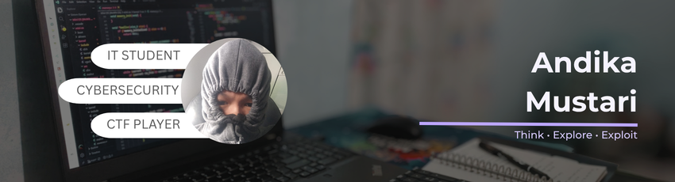

  

## 👨‍💻About Me

- 🎓 IT Students at the Kalimantan Institute of Technology
- 💻 Currently making personal website
- 🌱 Focused on cybersecurity, specifically OSINT (Open-Source Intelligence)
- 🎯 Goal: Becoming a Cybersecurity Specialist with a strong focus on OSINT and Threat Intelligence

## ⚙️Tech Stack

  #### Language
  
  
  

  #### Tools
  
  

 ## 📱Social Media & Contact

  
  
  
  
  
  
  
  

## Github Stats

  

